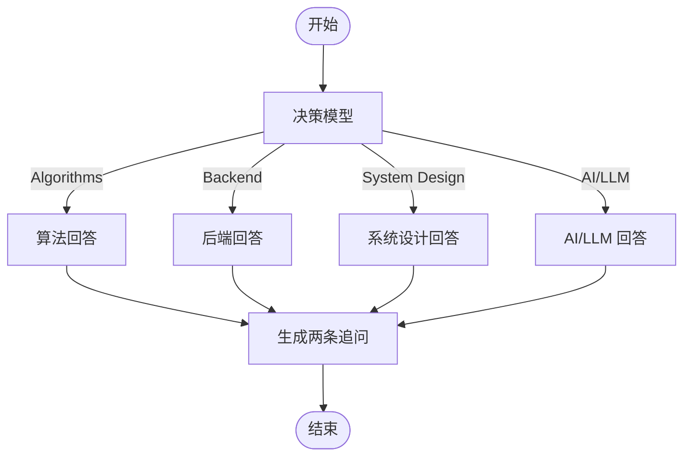

# 技术面试教练

Generative AI — HW 7-2，基于 HW 6-1 的 LangGraph 面试练习项目改进。

输入一道技术面试题，应用会先决定回答方向，再生成该方向的参考回答和两条深入追问。界面和生成内容使用中文，必要的技术名称保留英文。

## 本次改进

本次加入 OpenRouter 接入和基于 LLM 的分支选择：

| 要求 | 实现 |
| --- | --- |
| LLM 分支选择 | `decision_model` 节点输出类别和简短依据，LangGraph 条件边据此选择一个专家回答节点。 |
| 使用路由服务 | 所有模型请求发送到 OpenRouter；决策模型与回答模型可分别配置。 |

这里的 `decision_model` 是节点名称，默认仍使用普通聊天模型生成 JSON 分类，并非 Jev 或 SemIf 这类专门的 Decision Model。OpenRouter 用作统一 API 入口，目前没有按题目复杂度动态切换回答模型。因此，本版本不将 Extra Credit 标为已完成。

原作业是“分类 → 通用回答 → 追问”的固定流程。本次分类结果实际控制执行分支，每个回答节点有独立的专业提示：算法强调复杂度和边界情况，后端强调实现与性能，系统设计强调架构与权衡，AI/LLM 强调原理、评估和应用限制。



决策节点只选择一个分支，不会执行全部专家。一次成功练习包含三次模型请求：决策、回答、追问。OpenRouter 是统一模型服务入口；LangGraph 条件边负责程序内部的分支选择。

## 本地运行

建议使用 Python 3.12；项目要求 Python 3.11 或以上。

```bash
python3.12 -m venv .venv
source .venv/bin/activate
python -m pip install -r requirements.txt
cp .env.example .env
```

如果已经有 `.env`，直接编辑，避免覆盖现有配置：

```dotenv
OPENROUTER_API_KEY=your_openrouter_api_key_here
DECISION_MODEL=openai/gpt-4.1-mini
ANSWER_MODEL=openai/gpt-4.1-mini
```

将占位内容替换为老师提供的 OpenRouter 密钥。旧作业的 `OPENAI_API_KEY` 和 `OPENAI_MODEL` 不再使用。OpenAI 的密钥不能替代 OpenRouter 密钥。

```bash
python -m streamlit run app.py
```

打开 http://localhost:8501。首次启动如果询问邮箱，可以直接按回车跳过。修改 `.env` 后需要重启应用；已有的系统环境变量优先于 `.env`。

决策和生成是两个独立配置的模型角色，默认使用相同的模型，方便运行。可以将 `DECISION_MODEL` 换成其他支持 JSON 模式的模型；`ANSWER_MODEL` 也需要支持 JSON 模式，因为生成追问时使用该格式。模型标识使用 OpenRouter 的完整名称，例如 `openai/gpt-4.1-mini`。更换模型前应确认密钥的访问权限、余额和模型能力。

## 使用与演示

输入问题并点击“生成回答”。结果下方展开“查看决策与执行信息”，可以看到决策依据、实际执行路径、服务名称以及两个模型配置。

可分别尝试：

- 算法：如何在有序数组中使用二分查找？分析时间和空间复杂度。
- 后端：数据库索引如何加快查询？它会带来哪些代价？
- 系统设计：如何设计一个支持高并发访问的短链接服务？
- AI/LLM：RAG 和微调分别适合什么场景？如何评估效果？

实际分类由模型决定，跨领域题目可能进入不同分支。每道题独立处理，练习记录只保存在当前浏览器会话中，刷新或重启可能清空。

## 实现结构

- `graph.py`：状态定义、决策输出校验、条件边、四个回答节点、追问生成和 OpenRouter 错误处理。
- `app.py`：中文界面、会话历史以及决策和执行信息展示。
- `tests/test_app.py`：真实图执行、SDK 请求和 Streamlit 界面的离线测试。
- `.env.example`：配置模板；`.gitignore` 排除本地密钥、虚拟环境和缓存。

`run_interview(question)` 保留原入口。`InterviewState` 保留 `question`、`category`、`answer`、`follow_ups`，并增加 `decision_reason`、`route`、`execution_path`、`decision_model`、`answer_model` 和 `provider`。`build_graph(client, model, decision_model=None)` 支持分别指定生成和决策模型。

决策响应必须包含有效类别和非空理由；追问必须恰好两条、非空且不重复。无效结果会终止本次执行并显示错误，已有历史不受影响。认证失败时检查密钥，限流或额度不足时检查余额，连接失败时检查网络和代理。HTTP 错误会显示状态码。

## 验证

```bash
python -m py_compile app.py graph.py tests/test_app.py
python -m unittest discover -s tests -v
python -m pip check
```

如果使用 uv 管理环境，依赖检查也可以运行 `uv pip check --python .venv/bin/python`。

离线测试隔离外部网络，覆盖四条分支、不同模型配置、OpenRouter 请求格式、无效响应、常见 API 错误，以及界面历史保留。测试不会产生真实模型费用。AppTest 在独立运行时可能输出 `missing ScriptRunContext` 提示，不影响测试结果。

2026-11-17 已使用 OpenRouter 密钥完成两次真实流程验证，决策和生成均使用 `openai/gpt-4.1-mini`：

| 验证方式 | 问题 | 结果 |
| --- | --- | --- |
| 直接调用 `run_interview()` | 数据库索引如何加快查询，有哪些代价？ | 进入 `backend_answer`，返回中文回答和两条追问，约 8 秒。 |
| Streamlit AppTest 提交表单，真实调用 API | 有序数组的二分查找及其复杂度 | 进入 `algorithms_answer`，结果写入练习历史，返回中文回答和两条追问，无界面异常。 |

同时启动了 Streamlit 服务，健康检查返回 HTTP 200。9 项离线测试、语法检查和依赖检查通过。界面提交流程使用 AppTest 验证，未进行浏览器视觉检查。这些是本地验证结果，不是 GitHub Actions 记录。密钥只保存在被 Git 忽略的本地 `.env` 中。

## 参考资料

- [LangGraph Graph API](https://docs.langchain.com/oss/python/langgraph/graph-api)
- [OpenRouter 快速开始](https://openrouter.ai/docs/quickstart)
- [OpenRouter 模型列表](https://openrouter.ai/models)
- [Streamlit AppTest](https://docs.streamlit.io/develop/api-reference/app-testing/st.testing.v1.apptest)
