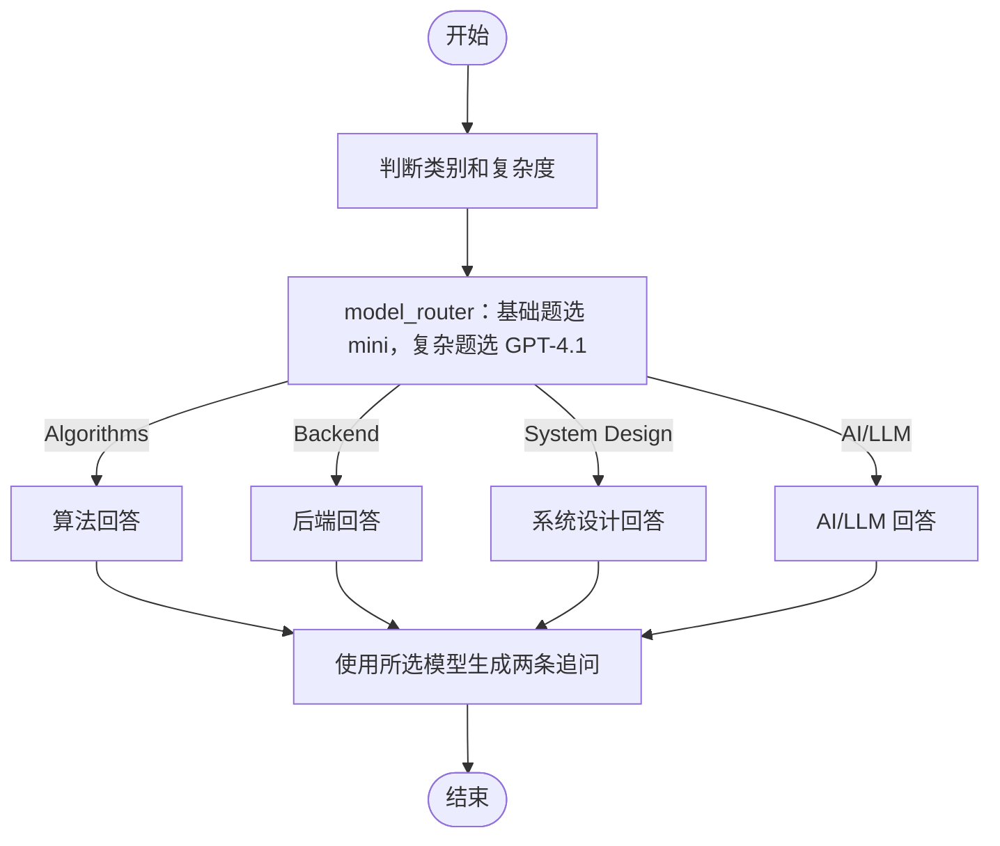

# 技术面试教练

Generative AI — HW 7-2，基于 HW 6-1 的 LangGraph 面试练习项目。

输入一道技术面试题，应用会判断题目方向和复杂度，选择回答模型，再生成中文参考回答和两条追问。

## 模型路由

本次改进采用 Router 方向：程序根据题目复杂度选择不同模型，通过 OpenRouter 发出请求。

| 角色 | 默认模型 | 用途 |
| --- | --- | --- |
| 分类 | `openai/gpt-4.1-mini` | 判断专业方向和复杂度，返回简短依据。 |
| 基础题回答 | `openai/gpt-4.1-mini` | 概念解释、单一机制、常见基础算法。 |
| 复杂题回答 | `openai/gpt-4.1` | 多步推理、多约束权衡、分布式架构、复杂算法证明。 |

`decision_model` 输出 `category`、`complexity` 和 `reason`。`model_router` 根据 `complexity` 从配置的两个回答模型中选择一个，将其写入状态的 `answer_model`。后面的回答与追问节点都使用这个模型。模型名称来自本地配置，分类响应不能任意指定模型。

复杂度与专业类别分别判断：一道后端题可以是基础概念，也可以涉及复杂的分布式事务。分类不只依据题目长度或类别，结果仍可能存在误判。每次成功练习只产生三次模型请求；路由节点本身不调用 API。

这里的分类器是普通聊天模型，并非 Jev 或 SemIf 这类专门的 Decision Model。本版本实现模型路由，不声称完成该 Decision Model 加分项。



四个回答分支有各自的提示：算法强调复杂度和边界情况，后端强调实现与性能，系统设计强调架构与权衡，AI/LLM 强调原理、评估和局限。每次只执行其中一个分支。

## 本地运行

建议使用 Python 3.12，最低支持 Python 3.11。

```bash
python3.12 -m venv .venv
source .venv/bin/activate
python -m pip install -r requirements.txt
cp .env.example .env
```

如果已有 `.env`，直接编辑，避免覆盖现有配置：

```dotenv
OPENROUTER_API_KEY=your_openrouter_api_key_here
DECISION_MODEL=openai/gpt-4.1-mini
ANSWER_MODEL=openai/gpt-4.1-mini
COMPLEX_ANSWER_MODEL=openai/gpt-4.1
```

填入老师提供的 OpenRouter 密钥。`ANSWER_MODEL` 是基础题模型，`COMPLEX_ANSWER_MODEL` 是复杂题模型；两者应配置为不同模型，才能体现模型路由。三个模型都需要支持 JSON 模式，回答模型还负责生成 JSON 格式的追问。更换模型前确认访问权限、余额和模型能力。

旧作业的 `OPENAI_API_KEY`、`OPENAI_MODEL` 不再使用。OpenAI 密钥不能替代 OpenRouter 密钥。修改 `.env` 后重启应用；系统环境变量优先于 `.env`。

```bash
python -m streamlit run app.py
```

打开 http://localhost:8501。首次启动如果询问邮箱，可以直接按回车跳过。

## 使用与演示

输入问题并点击“生成回答”。展开结果下方的“查看决策与执行信息”，可以看到复杂度、选择依据、执行路径、分类模型和本次选用的回答模型。

可以先用这两道题比较路由结果：

- 基础题：什么是数据库索引？请简单解释。
- 复杂题：设计一个跨三个地域、日活千万的短链接服务。分析分区期间的一致性与可用性权衡，给出容量估算、全局唯一 ID、缓存热点和地域故障恢复方案。

也可以练习二分查找、数据库事务、系统设计或 RAG 等问题。每道题独立处理，历史只保存在当前浏览器会话中，刷新或重启可能清空。失败的请求不写入历史。

## 代码结构

- `graph.py`：分类校验、模型选择、LangGraph 条件边、四个回答分支和 API 错误处理。
- `app.py`：中文界面、练习历史和本次路由信息。
- `tests/test_app.py`：图执行、模型选择、SDK 请求和界面的离线测试。
- `.env.example`：配置模板。本地密钥、虚拟环境和缓存由 `.gitignore` 排除。

入口仍为 `run_interview(question)`。`build_graph(client, model, decision_model=None, *, complex_model=...)` 中，`model` 是基础题模型。状态保留问题、类别、回答和追问，并记录复杂度、选择依据、执行路径及所选模型。

分类必须包含有效类别、`simple` 或 `complex` 复杂度及非空理由；追问必须恰好两条，非空且不重复。无效响应会停止本次执行。认证失败时检查密钥，限流或额度不足时检查余额，连接失败时检查网络和代理。HTTP 错误会显示状态码。

## 验证

```bash
python -m py_compile app.py graph.py tests/test_app.py
python -m unittest discover -s tests -v
python -m pip check
```

使用 uv 时，也可以运行 `uv pip check --python .venv/bin/python`。

10 项离线测试覆盖四个专业分支、两种复杂度的模型选择、回答和追问的模型一致性、OpenRouter 请求格式、无效响应、常见 API 错误及界面历史。离线测试不会产生模型费用。AppTest 独立运行时可能出现 `missing ScriptRunContext` 提示，不影响测试结果。

2026-11-17 使用 Streamlit AppTest 提交上面的两道演示题，并真实调用 OpenRouter：

| 问题 | 分类结果 | 所选回答模型 | 结果 |
| --- | --- | --- | --- |
| 数据库索引概念 | 后端、基础题 | `openai/gpt-4.1-mini` | 回答和两条追问成功，约 8 秒。 |
| 跨地域短链接服务 | 系统设计、复杂题 | `openai/gpt-4.1` | 回答和两条追问成功，约 15 秒。 |

两次结果均写入会话历史，无界面异常。语法和依赖检查通过。以上为本地测试记录，不是 GitHub Actions 结果；未进行浏览器视觉检查。密钥仅保存在被 Git 忽略的 `.env` 中。

## 参考资料

- [LangGraph Graph API](https://docs.langchain.com/oss/python/langgraph/graph-api)
- [OpenRouter 快速开始](https://openrouter.ai/docs/quickstart)
- [GPT-4.1 Mini](https://openrouter.ai/openai/gpt-4.1-mini)
- [GPT-4.1](https://openrouter.ai/openai/gpt-4.1)
- [Streamlit AppTest](https://docs.streamlit.io/develop/api-reference/app-testing/st.testing.v1.apptest)
